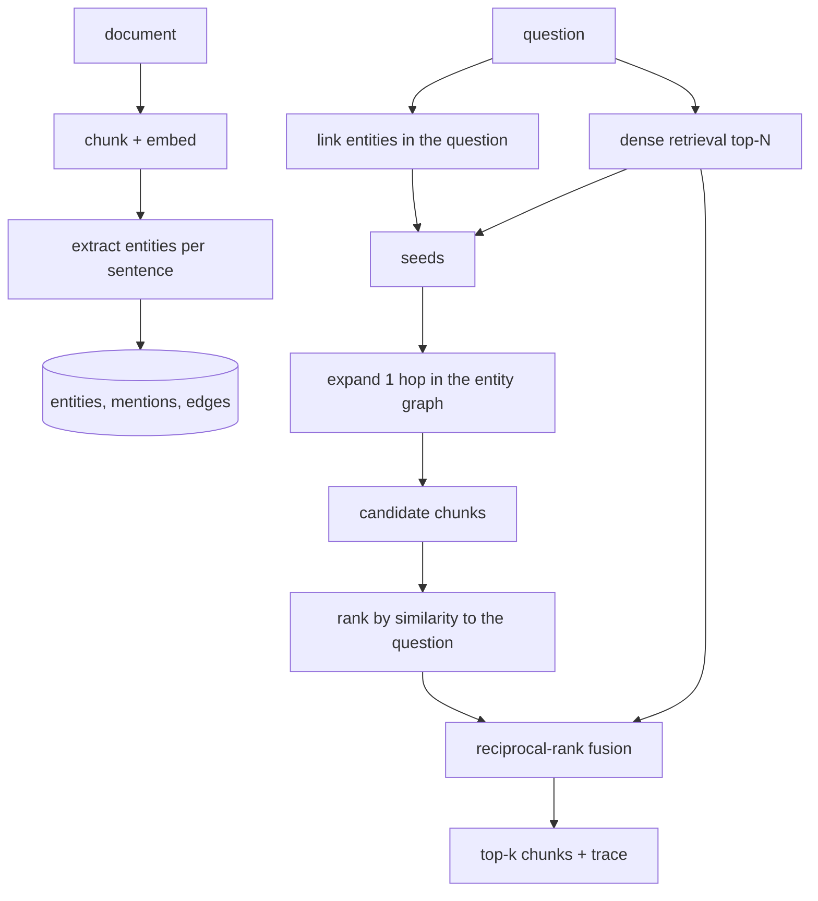

# graphhop: GraphRAG for multi-hop questions

Normal RAG finds passages that look like the question. For a question like "Where is the company that engineer Alice Smith founded located?", the second passage (about the company) shares no words with the question, so it gets missed. graphhop builds a graph of the entities in the documents and uses it to find that second passage.

## What I did
- Built an ingestion step that splits documents into chunks, embeds them, finds entities in each sentence and stores chunks, mentions and graph edges. Re-ingesting or deleting a document undoes exactly its edges.
- Built a query step: link the entities in the question, expand one hop in the entity graph, rank the candidate chunks by similarity to the question, and merge that ranking with normal vector search using reciprocal-rank fusion.
- First tried personalised PageRank for the graph part. It was worse than vector search at k=2, so I switched to "the graph proposes candidates, similarity ranks them".
- Added an HTTP API, a command line tool, a trace showing which entities were found, and optional cited answer generation.
- Evaluated on HotpotQA: 500 questions pooled into a corpus of about 4,900 paragraphs, with the same embeddings (`BAAI/bge-small-en-v1.5`) for every method.

## Results
Pair@k is the share of questions whose whole set of supporting paragraphs is in the top k. This is on questions 500 to 1000, which I had not looked at while designing the method.

| Method | Pair@2 | Pair@5 | Pair@10 |
|---|---:|---:|---:|
| vector search | 0.516 | 0.772 | 0.852 |
| graph only | 0.524 | 0.712 | 0.748 |
| hybrid, PageRank (first version) | 0.456 | 0.804 | 0.908 |
| **hybrid, expand (final)** | **0.556** | **0.848** | **0.924** |

- Over vector search: Pair@2 +4.0 points, Pair@5 +7.6 points (95% CI +3.6 to +11.6), Pair@10 +7.2 points.
- On the first 500 questions the gain was smaller: Pair@5 0.768 to 0.800.
- It does not help comparison questions like "Were X and Y the same nationality?", because vector search already gets those.

Raw outputs are in [`results/`](results/).

## How it was built

On the 500-question corpus the graph has about 36,000 entities and 151,000 edges.

## Tech stack
Python, FastAPI, Pydantic, SQLite, NetworkX, fastembed (bge-small embeddings), SciPy, pytest (42 tests), Docker.
