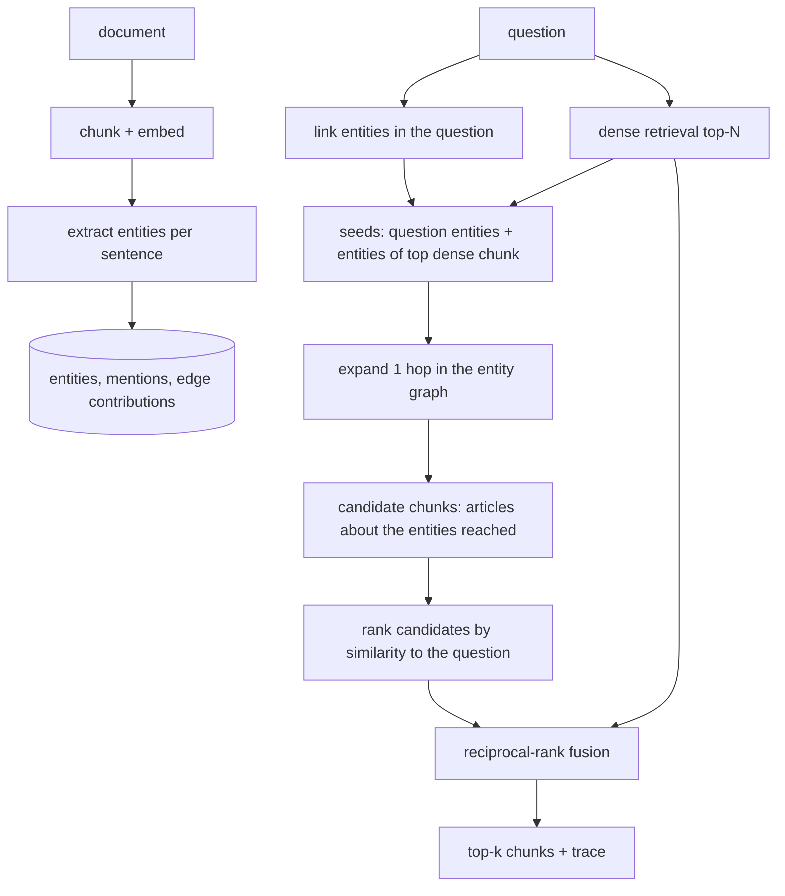

# graphhop: GraphRAG for multi-hop questions

Plain RAG ranks passages by similarity to the question. That fails on questions whose answer needs a **second passage that shares no words with the question**: *"Where is the company that engineer Alice Smith founded located?"* needs the passage about Alice Smith *and* the passage about her company, and only the first one looks like the question.

`graphhop` builds an **entity graph** from your documents and uses it to find the second hop: entities in the question lead to neighbouring entities, whose articles are pulled in as candidates and re-ranked by similarity, then fused with ordinary vector retrieval.

## Does it work? Measured results

**Setup.** HotpotQA (distractor setting, validation split). The paragraphs of 500 questions are pooled and de-duplicated into a corpus of about 4,900 paragraphs, so the retriever must find the right paragraphs among thousands, not among ten. For each question the gold set is its supporting paragraphs (usually two). **Pair@k** is the share of questions whose *entire* gold set is in the top *k*, which is what multi-hop answering needs. Embeddings: `BAAI/bge-small-en-v1.5`, identical for every method. Parameters are tuned on the dev half (even-numbered questions) and every number below is on the held-out **test half (250 questions)**. 95% intervals are paired bootstrap over questions. No LLM is involved, so every number is measured.

### Independent slice: questions 500 to 1000 (never looked at while designing the method)

| Method | Pair@2 | Pair@5 | Pair@10 | SP-Recall@5 |
|---|---:|---:|---:|---:|
| vector (baseline) | 0.516 | 0.772 | 0.852 | 0.878 |
| graph only | 0.524 | 0.712 | 0.748 | 0.824 |
| hybrid, PageRank (first version) | 0.456 | 0.804 | 0.908 | 0.890 |
| **hybrid, expand (default)** | **0.556** | **0.848** | **0.924** | **0.914** |

Difference of the default hybrid over vector, with 95% CI: **Pair@2 +4.0 pts [+0.4, +7.6]**, **Pair@5 +7.6 pts [+3.6, +11.6]**, **Pair@10 +7.2 pts [+4.0, +10.8]**. On the 200 bridge questions Pair@5 goes from 0.715 to 0.820.

### First slice: questions 0 to 500 (used to find the weakness of the first version, so not a clean test)

| Method | Pair@2 | Pair@5 | Pair@10 | SP-Recall@5 |
|---|---:|---:|---:|---:|
| vector (baseline) | 0.468 | 0.768 | 0.884 | 0.884 |
| graph only | 0.476 | 0.672 | 0.740 | 0.820 |
| hybrid, PageRank (first version) | 0.436 | 0.784 | 0.920 | 0.888 |
| **hybrid, expand (default)** | **0.504** | **0.800** | **0.916** | **0.900** |

Default hybrid over vector: Pair@2 +3.6 pts [0.0, +7.2], Pair@5 +3.2 pts [-0.01, +6.8], Pair@10 +3.2 pts [+0.4, +6.0].

### How to read this

- **The graph helps, moderately.** On the clean slice it is a clear gain (+7.6 points at k=5, interval well above zero). On the first slice the gain is smaller and the k=5 interval touches zero. Averaging the two slices gives roughly +5 points; I would not claim more than "a few points".
- **The first version was not good enough, and I changed it.** The original graph channel used personalised PageRank. It was *worse* than vector search at k=2 (significantly so on the clean slice). Diagnostics showed why: for 196 of 198 bridge questions in the first test half, all gold paragraphs were reachable from the question's entities (138 within one hop), so the information was in the graph, but PageRank mass could not tell which of hundreds of neighbours mattered. The fix is the default now: **the graph proposes candidates, similarity ranks them**. The old behaviour stays available (`graph_strategy=ppr`) and in the tables above for transparency. The `expand` design was chosen on the *dev* half of the first slice, then confirmed on the untouched second slice.
- **Graph alone is not enough.** Used by itself it is worse than vector search at k≥5; the value is in fusing the two.
- **It does not help comparison questions** ("Were X and Y of the same nationality?"), where both entities appear in the question and vector search is already near perfect (≥ 0.94 Pair@5; the small differences are within noise on about 50 questions).
- **Tuning on dev did not beat the defaults** on the clean slice (Pair@5 0.832 vs 0.848); with a grid this small, differences like that are noise.

### What is *not* measured

- **End-to-end answer accuracy (exact match / F1).** That needs an LLM and was not run. Retrieval recall is an upper bound on what an answerer can use, not a measure of answers.
- Other datasets, other embedding models, non-encyclopedic text, and corpora larger than a few thousand paragraphs. HotpotQA is Wikipedia text, which suits the capitalised-name extractor and the "an article is about its title" assumption (`title_as_entity`). Expect smaller gains on text without that structure.

Raw outputs: [`results/`](results/) (JSON with the full dev-sweep grid, and the printed tables). Reproduce: see [Reproducing the benchmark](#reproducing-the-benchmark).

## How it works



**Ingestion** (one transaction per document): chunk, embed, extract entities, store chunks, entity mentions and per-document edge contributions. Edge weights are derived from the contributions, so re-ingesting or deleting a document undoes exactly its effect. The default extractor is pure Python (capitalised name phrases, no model, no compiled dependency). The document title is also an entity linked to everything the document mentions. On the 500-question corpus the graph has about 36,000 entities and 151,000 edges.

**Query**: link entities in the question (exact name, unique last-name style match, then shorter sub-spans) → expand through the graph → rank the candidates by similarity to the question → fuse with global vector ranking using reciprocal-rank fusion. The response includes a **trace** (which entities were found, which were reached) so a result can be explained.

**Entity graph limits to know:** edges are co-occurrence within a sentence plus title links, entities are untyped, there is no coreference resolution ("She founded Zorbco" does not link Alice to Zorbco), and entities are identified by normalised name so two different entities with the same name merge. An **LLM extractor** that returns validated typed triples is included (`GH_EXTRACTOR=llm`) but has not been run against a live model.

## Quickstart

```bash
pip install -e ".[dev]"
graphhop ingest wiki ./my_docs              # .txt / .md files; the file name is the document title
graphhop query wiki "Where is the company that engineer Alice Smith founded located?" -k 5
graphhop serve                              # HTTP API on :8000
```

Example (illustrative output):

```json
{
  "trace": {"query_entities": ["Alice Smith"],
            "top_entities": [["Alice Smith", 1.0], ["Zorbco", 0.5]]},
  "results": [
    {"document": "my_docs/Alice_Smith.md", "score": 0.0164, "dense_rank": 0, "graph_rank": 0},
    {"document": "my_docs/Zorbco.md",      "score": 0.0159, "dense_rank": 7, "graph_rank": 1}
  ]
}
```

Generation is optional. Configure an LLM and add `"generate": true` to a request to get a cited answer (citations are validated against the supplied passages; the model can abstain):

```bash
export GH_LLM_PROVIDER=anthropic            # or openai_compat (OpenAI, Ollama, vLLM, ...)
export GH_LLM_MODEL_ID=<model id>
export GH_LLM_API_KEY_ENV=ANTHROPIC_API_KEY # NAME of the variable holding the key
```

## API

| Method | Route | Auth | Purpose |
|---|---|---|---|
| POST | `/v1/query` | none | `{collection, query, mode: vector\|graph\|hybrid, k, generate, graph_strategy, w_graph, w_dense, max_hops}` |
| PUT | `/v1/collections/{name}/documents` | admin key | idempotent upsert `{external_id, title, text}` |
| DELETE | `/v1/collections/{name}/documents/{id}` | admin key | delete a document and its graph contribution |
| GET | `/v1/collections/{name}/stats` | none | documents, chunks, entities, edges |
| GET | `/healthz` | none | liveness |

## Configuration

Environment variables with prefix `GH_` (see `.env.example`); changing them needs a restart. Retrieval parameters can also be overridden per request. Provider keys are referenced by variable name and never stored.

| Group | Variables |
|---|---|
| storage / models | `GH_DB_PATH`, `GH_EMBEDDING_MODEL` |
| ingestion | `GH_CHUNK_CHARS`, `GH_CHUNK_OVERLAP_CHARS`, `GH_TITLE_AS_ENTITY`, `GH_EXTRACTOR` (`proper_noun` or `llm`) |
| retrieval | `GH_GRAPH_STRATEGY` (`expand` or `ppr`), `GH_EXPAND_HOPS`, `GH_TITLE_ONLY`, `GH_SEED_FROM_DENSE_TOP_N`, `GH_W_GRAPH`, `GH_W_DENSE`, `GH_MAX_HOPS`, `GH_PPR_ALPHA`, `GH_DEFAULT_K`, `GH_MAX_K` |
| generation | `GH_LLM_PROVIDER`, `GH_LLM_MODEL_ID`, `GH_LLM_BASE_URL`, `GH_LLM_API_KEY_ENV`, `GH_LLM_MAX_TOKENS`, `GH_ADMIN_API_KEY` |

Full specification, failure matrix and decision records: [`docs/SPEC.md`](docs/SPEC.md).

## Reproducing the benchmark

```bash
pip install -e ".[dev]" pyarrow
python scripts/download_hotpot.py                    # -> data/hotpot_validation.parquet
graphhop eval-hotpot data/hotpot_validation.parquet -n 500 --offset 500 \
    --db data/eval_b.db --out results/my_run.json     # embedding ~5,000 paragraphs took about 13 minutes on a 16-core CPU
```

Add `--reuse-db` to re-run retrieval experiments on an existing index (only the questions are embedded), and `--offset 0` for the first slice. The harness tunes on the dev half over both graph strategies and reports the chosen setting, the defaults, the first-version PageRank configuration and the baselines on the test half.

## Limitations

- Retrieval evaluation only; answer accuracy not measured. Generation was run live once on a small local model (Ollama `llama3.2:3b`): the multi-hop example question retrieved both documents and was answered correctly from the second hop with a citation. LLM-based *extraction* has not been run against a real model, and the Anthropic client has only been tested against a local server imitating its wire format.
- The default extractor targets English, capitalised-name text. Languages without capitalisation, or text where entities are lowercase, need the LLM extractor or a different one.
- In-memory graph per collection (networkx): fine for tens of thousands of entities; not for millions.
- No permissions or multi-tenancy; do not index content that some callers must not see (see the sibling project `permission-aware-rag`).

## Development

```bash
pip install -e ".[dev]"
pytest -q                       # 42 tests (11 of them exercise the LLM clients against a local server)
ruff check src tests && ruff format --check src tests
mypy src
```

Tests cover the extractor, ingestion idempotency and exact undo on replace/delete, the synthetic multi-hop case (vector search misses the second hop, hybrid finds it, for both graph strategies), entity linking, hub pruning, generation validation, and the API. Test doubles (a hashing embedder and a fake LLM) exist only under `tests/`. A `Dockerfile` is included and was not built in the development environment.

## License

MIT
